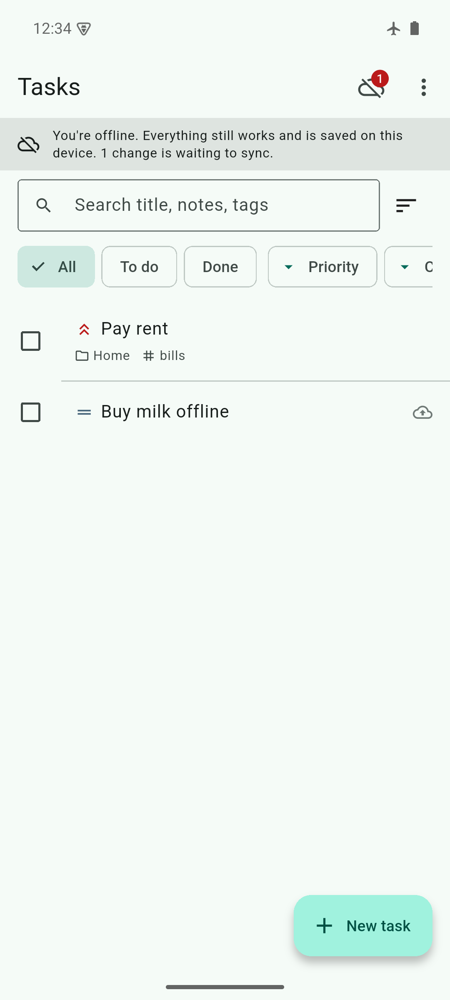
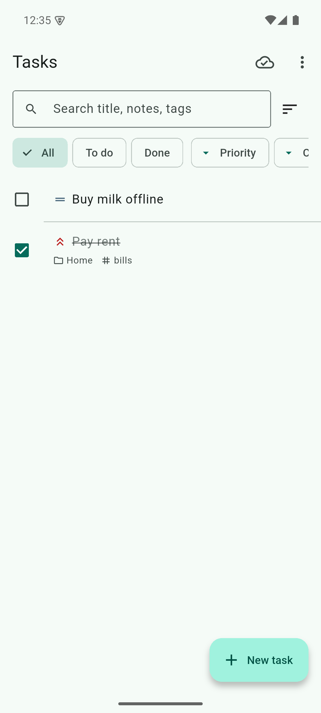
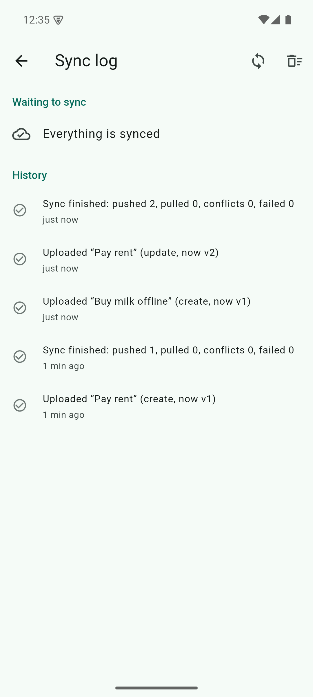
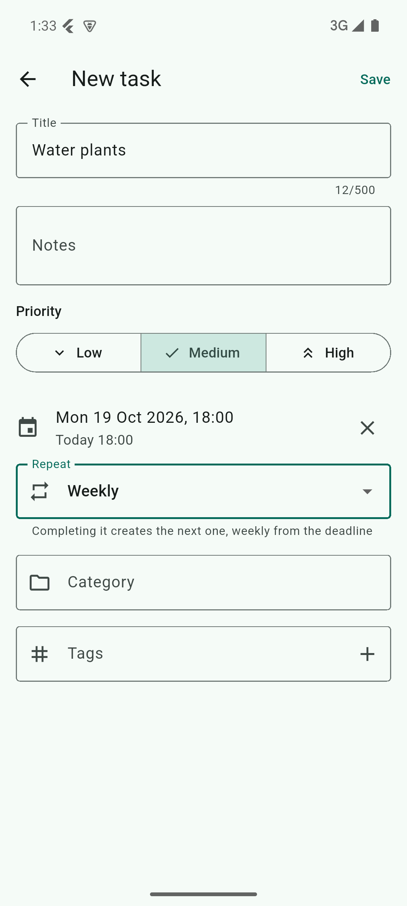
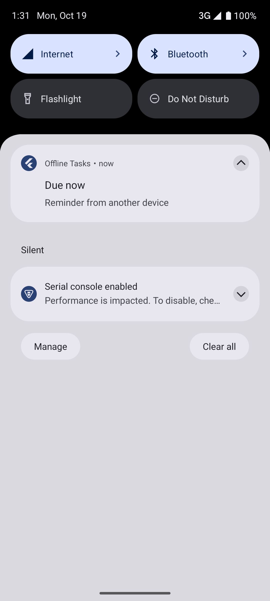

# Offline Tasks

An offline-first task manager for Android, built with Flutter, with a local
SQLite database (Drift) that syncs to Supabase. The app is fully usable with no
network: every change is saved on the device first and synced later. Edits made
on two devices while both were offline are merged field by field.

| Offline | Back online | Sync log | Editor | Reminder |
|---|---|---|---|---|
|  |  |  |  |  |

---

## For evaluators

### Demo account

| | |
|---|---|
| Email | `DEMO_EMAIL` ← *to be filled in* |
| Password | `DEMO_PASSWORD` ← *to be filled in* |

Install the APK (see [Build](#build)), open **⋮ → Account** and sign in. The
app also works without an account: tasks stay on the device, and they are
uploaded the first time you sign in.

### Reproduce offline sync (about 2 minutes)

1. Sign in and create a task, for example *Pay rent*. The cloud icon in the
   app bar shows a tick once it has synced.
2. Turn on **airplane mode**. A banner says *You're offline*.
3. Tick *Pay rent* as done and create a second task. Each changed task shows a
   **cloud-upload badge**, and the banner counts the changes waiting to sync.
4. **Force-stop** the app (Settings → Apps → Offline Tasks → Force stop) and
   open it again. The tasks, the badges and the queue are all still there.
5. Turn airplane mode **off**. Within a few seconds the badges disappear and
   the icon shows a tick. **⋮ → Sync log** lists each upload. In the Supabase
   table editor, the `tasks` rows show the new values with `version`
   incremented.

### Reproduce a two-device conflict (about 3 minutes)

You need two devices (or two emulators) signed in to the **same** account.
[docs/demo-script.md](docs/demo-script.md) has the full walkthrough, including
how to create the second emulator.

1. On device A create *Buy milk*. On device B, tap the cloud button in the app
   bar to sync now (or wait up to a minute) until it appears.
2. Put **both** devices in airplane mode.
3. On A, rename the task to *Buy oat milk*. On B, mark it **done** and set its
   priority to **High**.
4. Turn A online, then B. Both devices end up with *Buy oat milk*, done, High
   priority: changes to different fields are all kept.
5. To see a same-field conflict, repeat with both devices editing the
   **title**. The edit with the later timestamp wins on both devices, and the
   other device's Sync log has a *Conflict on …* entry naming the field and
   which side was kept.

Recurring tasks: on both offline devices, tick off the same weekly task, then
bring both online. You get exactly **one** next occurrence, not two (see
[Recurring tasks](#recurring-tasks)).

---

## Setup

### 1. Supabase

1. Create a project at [supabase.com](https://supabase.com).
2. **Authentication → Providers → Email**: enabled. For testing, turn off
   *Confirm email*.
3. **SQL Editor**: run the migrations in order:
   1. [`supabase/migrations/20261018000000_tasks_sync.sql`](supabase/migrations/20261018000000_tasks_sync.sql):
      tables, RLS, and the atomic push function.
   2. [`supabase/migrations/20261019000000_order_and_recurrence.sql`](supabase/migrations/20261019000000_order_and_recurrence.sql):
      manual order and recurring tasks.

   Or, with the Supabase CLI: `supabase link --project-ref <ref>` and then
   `supabase db push`.
4. Optional: paste each file in [`supabase/tests/`](supabase/tests) into the
   SQL Editor. Each one rolls back and ends with a list of passed checks.

More detail is in [supabase/README.md](supabase/README.md).

### 2. `.env`

```sh
cp .env.example .env
```

| Key | Value |
|---|---|
| `SUPABASE_URL` | `https://<ref>.supabase.co` (no `/rest/v1`) |
| `SUPABASE_ANON_KEY` | The **anon / publishable** key from Project Settings → API. Never use the service_role key. |
| `SUPABASE_TEST_EMAIL`, `SUPABASE_TEST_PASSWORD` | Optional, for `test/live` only |

`.env` is gitignored. The keys are compiled in with `--dart-define-from-file`,
so no dotenv package is needed.

### 3. Build

Requires Flutter 3.47+ (Dart 3.13) and the Android SDK.

```sh
flutter pub get

# Run on a device or emulator
flutter run --dart-define-from-file=.env

# Release APK → build/app/outputs/flutter-apk/app-release.apk
flutter build apk --release --dart-define-from-file=.env
```

Without `--dart-define-from-file` the app runs local-only, with sync turned off.

The release build needs the R8 keep rules in
[`android/app/proguard-rules.pro`](android/app/proguard-rules.pro). Without
them, `shared_preferences_android`, which is called over JNI, crashes at
startup.

---

## Design

```
 UI (Riverpod) ──watches──▶ SQLite (Drift) ◀──writes── TaskRepository
                               │   tasks + sync_queue, one transaction
                               ▼
 SyncCoordinator ──when──▶ SyncEngine ──push outbox──▶ apply_task_change() ─┐
 (writes, reconnect,          │    ◀──pull deltas──── tasks (RLS) ◀────────┘
  resume, backoff, timer)     └─ three-way merge on conflict      Supabase
 WorkManager isolate ─────▶ SyncEngine (same DB file, cross-isolate lease)
```

The UI never calls the network. It reads from Drift streams, so every change
appears immediately and works the same online or offline.

### Local storage

Drift (SQLite, bundled through `package:sqlite3`) is the single source of truth.

- **Tables:** `tasks`, `sync_queue` (the outbox), `sync_log` (history shown in
  the app) and `sync_state` (pull cursor and lease).
- **Concurrency:** WAL mode lets the app and the WorkManager isolate share the
  database file.
- **Schema changes:** made with `drift_dev make-migrations`. Snapshots live in
  `drift_schemas/` and every migration step has a data-preservation test.
- **Deletes:** soft deletes (`is_deleted` tombstones), so a delete made offline
  still reaches the server and other devices.

### Outbox

Every create, update, delete or reorder writes the task **and** its
`sync_queue` entry in **one SQLite transaction**. A change therefore can't
exist without the entry that will sync it, even if the app is killed mid-write.

- **Order:** the queue is drained by an `AUTOINCREMENT seq`, never by
  wall-clock time.
- **Merging edits:** offline edits merge into the task's waiting entry, so ten
  edits are one request. Each entry carries the full row.
- **Edits during a push:** an entry being pushed (`in_flight`) is never merged
  into. An edit made meanwhile gets its own entry behind it, so it can't be
  lost when the push's acknowledgement deletes the first entry.
- **Deletion:** an entry is deleted only after the server acknowledges it.
- **Crash recovery:** an entry left `in_flight` by a crash is re-sent on the
  next run.

### Retry and backoff

- **Retryable failures** (offline, timeout, 5xx, expired JWT) back off at 2 s,
  4 s, 8 s and so on, capped at 5 minutes, plus 0–25% random jitter. A retryable
  failure stops the run, so other entries don't use up their attempts while the
  device is offline.
- **After 5 attempts** an entry is marked `failed` and shown in the Sync log
  with **Retry** and **Retry all**.
- **Permanent errors** (validation `22xxx`/`23xxx`, RLS `42501`) fail
  immediately.
- **Stale versions are not failures.** They are merged and re-pushed. After 3
  merge rounds in one run, the entry falls back to normal backoff.
- **When sync runs:** the coordinator syncs after local writes (debounced),
  on reconnect, on app resume, when a backoff is due, and every minute while
  online.
- **In the background:** WorkManager syncs every 15 minutes, and also flushes
  the queue when the app is backgrounded with changes pending, even if the app
  is then killed.
- **Lease:** a row in `sync_state` with an owner and an expiry, taken by one
  atomic upsert, keeps the app isolate and the WorkManager isolate from syncing
  at the same time.

### Online detection

`connectivity_plus` only reports that Wi-Fi or mobile data is up. A status of
*online* also requires a successful request to Supabase's
`/auth/v1/health`. A captive-portal Wi-Fi shows *server can't be reached*, and
the app keeps checking until the server answers.

### Idempotency

Duplicates are prevented by the database, not by app code:

- **Task ids** are client-generated UUIDs and the primary key, so a retried
  create can't make a second row.
- **Op ids:** each queue entry carries an `op_id`. `apply_task_change()`
  inserts it into `applied_ops` (primary key on `op_id`) **in the same
  transaction** as the write. A retry after a lost acknowledgement hits the
  key and gets `duplicate` with the current row; nothing is written twice.
- **Atomic push:** the function checks the op id, checks the version and
  writes, all or nothing. A stale `base_version` raises SQLSTATE `PT409`
  (HTTP 409) with the current row attached, so the client can merge without
  another request. Other failures have their own codes.
- **Unknown ids:** a delete for an id the server never saw is stored as a
  tombstone, so create-then-delete offline is safe.

### Three-way merge

Each local task keeps a snapshot of the last server state it agreed with: the
common ancestor. When a push is stale, or a pull arrives while local edits are
queued, `mergeTask(base, local, remote)` runs per field:

| Case | Result |
|---|---|
| Both sides equal | Keep it |
| Only one side changed the field (vs base) | Take that side, so edits to different fields on two devices **both survive** |
| Both changed it, to different values | **Last-writer-wins** on the record's `updated_at`; logged as a conflict |
| Delete vs edit | `is_deleted` is just a field: the task stays deleted **and** keeps the edit, so restoring it brings back the edited version |

**Trade-off: same-field conflicts use device clocks.** `updated_at` is the
editing device's clock. If a phone's clock is wrong, its edits win or lose
same-field conflicts incorrectly. On an exact timestamp tie the server value
wins, so devices never flip-flop. Changes to different fields don't depend on
clocks at all. A server-assigned order or hybrid logical clocks would remove
the clock dependency, at the cost of more complexity than this app needs.

### Recurring tasks

Completing a daily, weekly or monthly task creates the next occurrence in the
same transaction. Its id is **UUIDv5(series id + next due time)**. Two devices
that complete the same occurrence offline therefore create the same task. The
second push is a stale create with identical content, which merges to nothing.
The result is one next task, not two.

Due dates advance in UTC, so devices in different time zones compute the same
id. The trade-off is that across a daylight-saving change the local time
shifts by an hour.

### Manual order

Drag-to-reorder uses **fractional indexing**: a base-62 `sort_key` between
the new neighbours, in the same format as `rocicorp/fractional-indexing`.

- **One row per move:** a move rewrites only the moved task, so it's one
  change to sync.
- **Concurrent moves:** moves of different tasks on two devices both survive.
  Moving the same task on both devices is an ordinary same-field conflict,
  resolved by last-writer-wins.
- **Ties:** equal keys from concurrent inserts are ordered by id, so every
  device shows the same order.

### Reminders

A deadline schedules a local notification. A reconciler compares the reminders
the database wants with what's scheduled, so local edits and pulls from other
devices are handled the same way: a pulled deadline change reschedules, and a
pulled completion or delete cancels.

- **Permission:** `POST_NOTIFICATIONS` is requested at runtime, the first time
  you save a task with a deadline.
- **Timing:** reminders use **exact** alarms only if the system already allows
  them, and otherwise **inexact** ones, which Android may deliver up to about
  an hour late for far-off deadlines.
- **Reboot:** the plugin's boot receiver reschedules reminders, and the next
  app start or background sync reconciles again.

### Sign-out safety

Signing out clears the device's data, so it never silently drops unsynced
changes. It first tries to sync everything. If anything is still unsynced, it
shows *"N unsynced changes will be lost"*, with **Cancel** as the default.

---

## Features checklist

| Area (weight) | Requirement | Where |
|---|---|---|
| **Offline & persistence** (25%) | Fully usable offline | UI reads Drift streams only; [task_repository.dart](lib/domain/task_repository.dart) |
| | Survives force-kill | Transactional outbox; [persistence integration test](integration_test/persistence_test.dart); checked on a release build |
| | Local DB with migrations | [database.dart](lib/data/db/database.dart), `drift_schemas/`, [migration tests](test/drift/app_database/migration_test.dart) |
| **Sync & conflicts** (30%) | Queue and retry with backoff | [sync_engine.dart](lib/data/sync/sync_engine.dart), [backoff.dart](lib/domain/backoff.dart) |
| | No duplicates | Client UUIDs, `applied_ops` primary key, atomic push ([migration](supabase/migrations/20261018000000_tasks_sync.sql)) |
| | Conflict resolution | Three-way field merge ([merge.dart](lib/domain/merge.dart)) |
| | Delta sync | `server_updated_at` cursor, paged, indexed `(user_id, server_updated_at)` |
| | Recovery | `in_flight` recovery, lost-ack replay, lease for background isolate |
| **Task management** (20%) | Create / edit / delete / complete | [task_edit_screen.dart](lib/presentation/screens/task_edit_screen.dart), swipe-to-delete with undo |
| | Priority, deadline, categories, tags | Editor and list chips |
| | Search and filter | Title/notes/category/tags search; status, priority and category filters; 5 sort orders |
| **UI/UX & state** (15%) | Online/offline indicator | [status_banner.dart](lib/presentation/widgets/status_banner.dart) with a real reachability check |
| | Pending-sync badge per task | [task_tile.dart](lib/presentation/widgets/task_tile.dart) |
| | Loading / empty / error states | [task_list_screen.dart](lib/presentation/screens/task_list_screen.dart) |
| **Code quality** (10%) | Layering | `data/` (db, api, sync, notifications) → `domain/` → `presentation/` |
| | Tests | 150+ Dart tests, 38 SQL checks, live and on-device tests (below) |

| Bonus | Status |
|---|---|
| Sync log screen | ✅ Queue with retry, plus full history (uploads, retries, conflicts and how they were resolved) |
| Multi-device sync | ✅ Email + password accounts; RLS isolates users |
| Deadline notifications | ✅ Runtime permission, exact/inexact, reboot-safe, follows pulls |
| Drag-to-reorder | ✅ Fractional indexing |
| Recurring tasks | ✅ Daily / weekly / monthly, deterministic next-occurrence ids |
| Background sync | ✅ WorkManager, periodic and flush-on-background |

---

## Tests

```sh
flutter test                                   # unit, engine, widget, migration
flutter test test/live --dart-define-from-file=.env   # against your Supabase project
flutter test integration_test -d <device>      # on an emulator or phone
cd tool/sqltest && npm install && npm test      # SQL + RLS on Postgres-in-WASM
```

- **Sync engine:** two simulated devices on a fake server that follows the same
  contract as the SQL function. Covers lost acknowledgements, backoff, the
  5-attempt limit, stale-version rounds, edits during a push, crash recovery,
  delta pull with pagination, three-way merge, the lease, recurring tasks on
  two devices, and concurrent reorders.
- **SQL:** RLS isolation between two users, idempotency, `PT409`, validation,
  no DELETE or TRUNCATE. Checked against deliberately broken policies to prove
  the tests catch regressions.
- **Widget:** list, editor, banners, badges, drag-to-reorder, and the sign-out
  confirmation.

## Project layout

```
lib/
  data/
    api/            Supabase client, auth, RemoteApi contract
    db/             Drift schema, migrations, row ↔ wire mapping
    notifications/  reminder reconciler + flutter_local_notifications
    sync/           SyncEngine, SyncCoordinator, connectivity, WorkManager
  domain/           TaskRepository, merge, backoff, recurrence, fractional index
  presentation/     screens, widgets, Riverpod providers
supabase/           migrations + SQL tests
tool/sqltest/       runs the SQL tests on PGlite
docs/               demo script, screenshots
```

## Known limitations

- Same-field conflicts depend on device clocks (see
  [Three-way merge](#three-way-merge)).
- Inexact reminders may arrive late unless the user allows exact alarms.
- `applied_ops` grows by one row per push. Pruning rows older than about 30
  days is safe (see [supabase/README.md](supabase/README.md)), but it isn't
  scheduled.
- Android only. The data and sync layers are platform-neutral, but
  notifications and WorkManager are only set up for Android.
